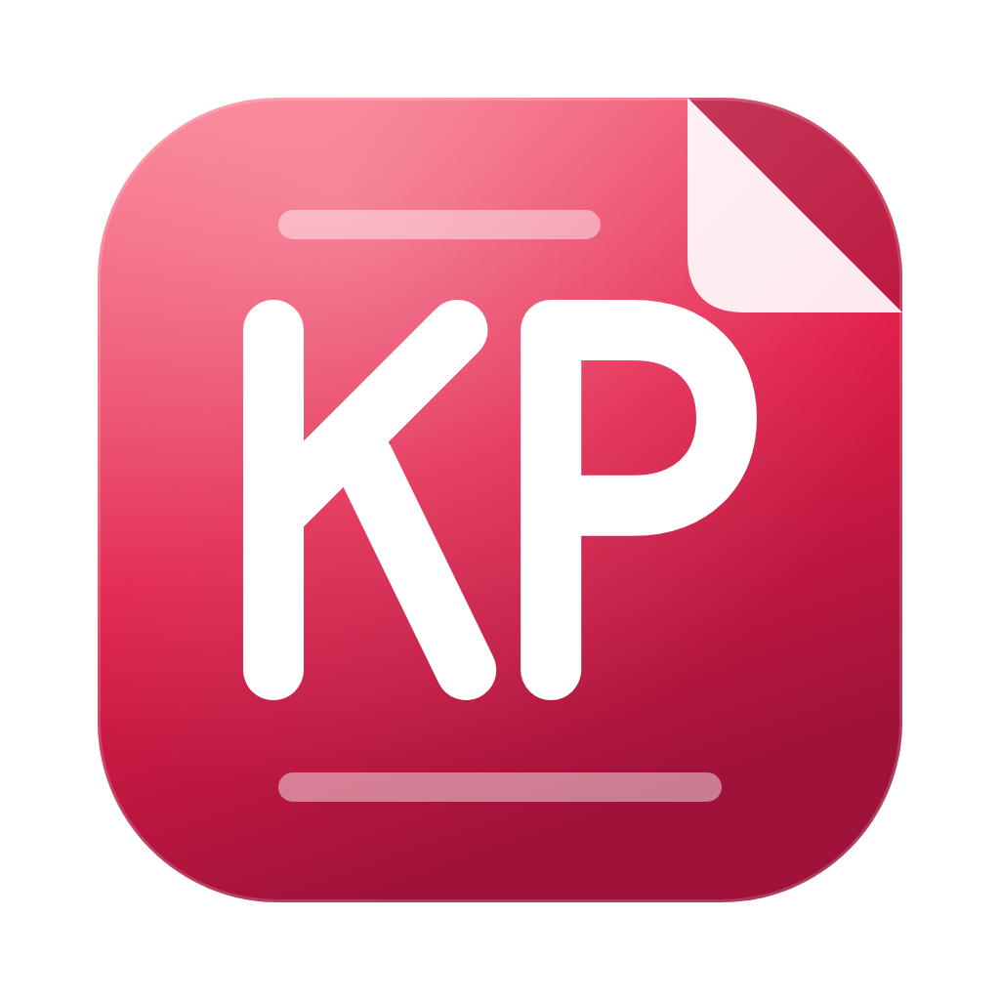
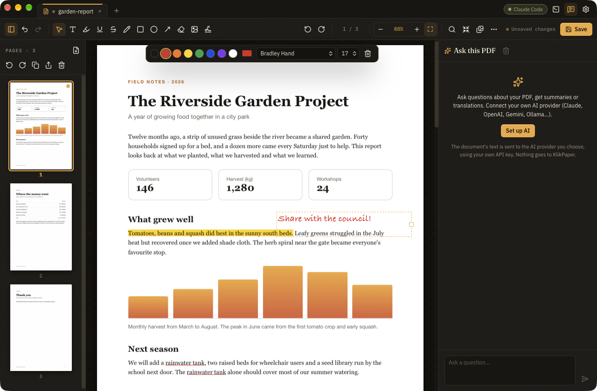

<p align="center">
  
</p>

<h1 align="center">KlikPaper</h1>

<p align="center"><a href="README.md">English</a> · <b>Bahasa Indonesia</b></p>

<p align="center">
  Aplikasi PDF desktop yang gratis dan open source. Lihat, atur, kompres, konversi, beri anotasi, tanda tangani, dan kunci PDF di komputer Anda sendiri, tanyakan isinya dengan API key AI milik Anda, atau biarkan agen AI yang sudah Anda pakai mengerjakannya lewat MCP. Kecil, cepat, dan offline.
</p>

<p align="center">
  <a href="LICENSE"></a>
  
  
  
  <a href="https://github.com/ashafizullah/klikpaper/actions/workflows/ci.yml"></a>
  <a href="https://github.com/ashafizullah/klikpaper/releases/latest"></a>
  <a href="https://github.com/ashafizullah/klikpaper/releases"></a>
</p>

<p align="center">
  <a href="https://trakteer.id/adamshafizullah/tip"></a>
</p>

<p align="center">
  Bagian dari <a href="https://klikapps.pages.dev"><b>Klik Apps</b></a>, keluarga aplikasi desktop gratis dan open source: <a href="https://klikapps.pages.dev">klikapps.pages.dev</a>
</p>

<p align="center">
  
</p>


## Fitur

- **Penampil**: gulir kontinu yang cepat, zoom dan pas lebar, pilih teks, cari di dokumen, tautan yang bisa diklik, formulir yang bisa diisi, tab untuk beberapa PDF
- **Atur halaman**: seret thumbnail untuk mengurutkan ulang, putar, hapus, gandakan, sisipkan halaman dari PDF lain, gabung beberapa file, pisah per rentang atau setiap N halaman, simpan halaman terpilih sebagai PDF baru, ubah ukuran halaman ke A4, Letter, Legal, A3, atau A5 (isi diskalakan agar pas, tidak ditarik)
- **Kompres**: tiga tingkat atau slider kualitas sendiri yang mengecilkan dan mengodekan ulang foto; teks, grafik vektor, dan font tidak diubah. Setiap tingkat menampilkan ukuran file hasilnya sebelum Anda menyimpan
- **Konversi**: gambar (JPG, PNG, WebP, GIF, BMP, TIFF) ke PDF, dan halaman ke PNG atau JPEG
- **Edit teks**: klik satu baris untuk mengubah kata-katanya; KlikPaper menutup baris lama dan menuliskannya lagi dengan font, ukuran, dan warna yang mirip (kata lama tetap tersembunyi di bawahnya, jadi bukan cara untuk menyensor)
- **Anotasi**: sorot, garis bawah, dan coret teks (disimpan sebagai anotasi PDF asli yang bisa dilihat penampil lain), kotak teks dengan font apa pun yang terpasang di komputer Anda (disematkan saat disimpan), gambar tangan, persegi, elips, panah, penghapus putih, gambar
- **Tanda tangan**: gambar, ketik, atau unggah tanda tangan, lalu tempatkan dan ubah ukurannya. Ini gambar tanda tangan Anda, bukan tanda tangan digital berbasis sertifikat
- **Watermark dan nomor halaman**, langsung terlihat di setiap halaman
- **Kata sandi dan privasi**: buka PDF yang dikunci, kunci dengan AES-256, hapus kata sandi yang Anda ketahui, hapus metadata, ratakan isian formulir
- **Tanya PDF ini** (opsional): chat tentang dokumen yang terbuka, dengan jawaban yang merujuk halaman yang bisa diklik. Pakai key Anda sendiri untuk Anthropic (Claude) atau API apa pun yang kompatibel dengan OpenAI (OpenAI, OpenRouter, Gemini, Groq, Ollama...). AI-nya juga bisa memutar, memindah, atau menghapus halaman dan menambah teks saat Anda minta. Key disimpan di keychain sistem
- **Bekerja dengan agen AI Anda**: nyalakan server MCP lokal, lalu klien MCP apa pun (Claude Code, Codex, Gemini CLI, VS Code, Cursor, Windsurf, opencode, dan harness agen lain) bisa membaca dan mencari isi PDF yang terbuka, menyorot, menambah teks, bentuk, gambar, dan tanda tangan, mengatur halaman, serta menggabung, memisah, mengompres, mengunci, atau mengonversi file. Terminal bawaan menjalankan agen Anda tepat di samping dokumen
- **Urungkan dan ulangi** untuk perubahan halaman, anotasi, watermark, dan nomor halaman; tidak ada yang ditulis ke file sampai Anda menyimpan
- **Aksi klik kanan** (opsional): gabung, kompres, atau konversi PDF, atau ubah gambar jadi PDF, langsung dari menu File Explorer di Windows atau Quick Actions Finder di macOS
- **English dan Bahasa Indonesia** di seluruh aplikasi: antarmuka, bilah menu, pesan pembaruan, dan catatan "Yang baru"; **pembaruan otomatis** dari GitHub Releases (paket bertanda tangan), yang bisa Anda atur untuk terpasang sendiri, bertanya dulu, atau mati

## Privasi

KlikPaper bekerja offline. File Anda tidak pernah keluar dari komputer, dengan dua pengecualian yang Anda kendalikan:

- **Cek pembaruan** menanyakan versi yang lebih baru ke GitHub Releases dan, jika ada, mengambil catatan perubahannya dari GitHub (sekali sehari, atau hanya saat Anda minta jika cek otomatis dimatikan).
- **Chat AI**, jika Anda siapkan dan pakai, mengirim teks dokumen yang terbuka dan pertanyaan Anda ke penyedia AI yang Anda pilih, dengan API key Anda sendiri. Tidak ada yang dikirim ke KlikPaper atau pembuatnya.

Tidak ada akun, telemetri, maupun analitik.

## Unduh

Ambil versi terbaru dari **[Releases](https://github.com/ashafizullah/klikpaper/releases/latest)**:

| Platform | File |
|---|---|
| macOS 11+ (Apple Silicon & Intel) | `KlikPaper_x.y.z_universal.dmg` |
| Windows 10/11 (x64) | `KlikPaper_x.y.z_x64-setup.exe` atau `.msi` |
| Linux x86_64 | `.deb`, `.rpm`, atau `.AppImage` |

**macOS:** buka DMG lalu seret KlikPaper ke Applications. KlikPaper ditandatangani dan dinotarisasi Apple, jadi terbuka tanpa peringatan Gatekeeper. Atau pakai skrip instalasi, yang mengunduh DMG terbaru, menyalin KlikPaper ke Applications, lalu membukanya:

```sh
curl -fsSL https://raw.githubusercontent.com/ashafizullah/klikpaper/main/install.sh | bash
```

**Windows:** SmartScreen mungkin memperingatkan soal aplikasi yang belum ditandatangani. Klik **More info → Run anyway**.

## Memakai agen AI (MCP)

1. Buka **Pengaturan → Agen AI (MCP)** dan nyalakan server MCP lokal.
2. Pilih agen Anda dan salin langkah penyiapannya: perintah sekali jalan untuk Claude Code (`claude mcp add …`), Gemini CLI (`gemini mcp add …`), dan VS Code (`code --add-mcp …`), atau potongan konfigurasi untuk Codex (`~/.codex/config.toml`) dan Cursor (`~/.cursor/mcp.json`). KlikPaper adalah server MCP standar (Streamable HTTP dengan bearer token), jadi agen atau harness lain juga bisa: pilih **Lainnya** untuk mendapatkan URL server dan header `Authorization`.
3. Jalankan agen Anda (terminal bawaan KlikPaper, **Ctrl+`**, terbuka di folder dokumen) lalu minta, misalnya, *"gabungkan semua PDF di ~/Invoices jadi satu file urut tanggal"*, *"di dokumen yang terbuka, hapus halaman kosong dan tambahkan nomor halaman"*, atau *"sorot setiap penyebutan tenggat waktu"*.

Server hanya mendengarkan di `127.0.0.1` dan butuh token rahasia. KlikPaper tidak pernah menjalankan agen Anda, mengirimkan prompt kepadanya, atau menyentuh kredensialnya. Tool file tidak pernah menimpa file yang sudah ada kecuali diminta, dan hanya menulis file PDF, PNG, dan JPEG.

## Kebutuhan

- Tidak ada untuk tool PDF: semuanya bekerja offline
- Untuk **Tanya PDF ini**: API key untuk model chat (Claude, GPT, Gemini, OpenRouter…), atau server lokal yang kompatibel dengan OpenAI seperti Ollama
- Untuk **agen AI**: klien MCP atau harness agen apa pun yang mendukung Streamable HTTP (Claude Code, Codex, Gemini CLI, VS Code, Cursor, Windsurf, opencode…) di komputer yang sama

## Pengembangan

Butuh [Bun](https://bun.sh/) dan Rust stable. Di Linux, pasang juga [prasyarat Tauri](https://v2.tauri.app/start/prerequisites/#linux).

```sh
bun install
bun run tauri dev      # jalankan
bun run tauri build    # bundel
bun run check          # cek tipe
bun run test           # tes frontend
cargo test --manifest-path src-tauri/Cargo.toml
bun run notices        # cek lisensi + THIRD_PARTY_NOTICES.md
```

### Cara kerjanya

- `src/` adalah antarmuka Svelte 5. PDF.js merender halaman, lapisan teks, dan formulir; suntingan Anda ada di model dokumen (`src/lib/doc.svelte.ts`) berupa daftar halaman berurutan dari satu atau beberapa file plus anotasi, dengan riwayat urungkan.
- Saat menyimpan, daftar halaman dikirim ke Rust (`src-tauri/src/pdf/`), tempat lopdf menyusun file baru (gabung, urutkan ulang, putar, hapus), mengompres gambar, menghapus metadata, dan mengenkripsi. Anotasi, watermark, dan nomor halaman digambar dengan pdf-lib (`src/lib/draw.ts`) di antaranya.
- Webview hanya bisa membaca dan menulis PDF dan gambar (`src-tauri/src/files.rs`). API key tetap di keychain sistem dan tidak pernah sampai ke webview.

## Berkontribusi

Issue dan pull request dipersilakan. CI menjalankan cek tipe, tes, `cargo fmt`, `clippy`, `cargo test`, dan cek lisensi di macOS, Windows, dan Linux. Jalankan semuanya secara lokal sebelum membuka PR. Lihat [CONTRIBUTING.md](CONTRIBUTING.md) untuk penyiapan, pengecekan, dan panduan, termasuk aturan soal kode pihak ketiga.

### Merilis

Tambahkan bagian `## x.y.z` ke `CHANGELOG.md` dan bagian yang sama dalam bahasa Indonesia ke `CHANGELOG.id.md` (aplikasi menampilkan yang sesuai bahasa antarmuka setelah pembaruan), naikkan `version` di `tauri.conf.json`, `Cargo.toml`, dan `package.json`, lalu push sebuah tag. CI membangun DMG macOS yang ditandatangani dan dinotarisasi, installer Windows, dan paket Linux, menandatangani paket pembaruan, lalu melampirkan semuanya (termasuk `latest.json` untuk updater di aplikasi) ke draft release. Publikasikan draft itu untuk merilisnya.

Rilis butuh secret `TAURI_SIGNING_PRIVATE_KEY` (public key-nya ada di `tauri.conf.json`) plus `APPLE_CERTIFICATE`, `APPLE_CERTIFICATE_PASSWORD`, `APPLE_ID`, `APPLE_PASSWORD`, dan `APPLE_TEAM_ID` untuk penandatanganan dan notarisasi macOS.

```sh
git tag v0.1.1 && git push origin v0.1.1
```

Artwork installer Windows dan DMG di `src-tauri/installer/` dirender dari `design/installer/art.html` dengan `scripts/installer-art.sh`.

## Dukungan

KlikPaper gratis. Kalau aplikasi ini menghemat waktu Anda, **[traktir saya token AI di Trakteer](https://trakteer.id/adamshafizullah/tip)** ☕🤖.

## Lisensi

[MIT](LICENSE)

KlikPaper dibangun di atas [PDF.js](https://github.com/mozilla/pdf.js) (Apache-2.0), [pdf-lib](https://github.com/cantoo-scribe/pdf-lib) (MIT), dan [lopdf](https://github.com/J-F-Liu/lopdf) (MIT), serta menyertakan perangkat lunak pihak ketiga lain, termasuk font antarmuka Fraunces, IBM Plex Sans, dan IBM Plex Mono serta font Liberation Sans 2 untuk teks yang ditambahkan ke PDF (semuanya SIL Open Font License 1.1). Lisensinya ada di [`THIRD_PARTY_NOTICES.md`](THIRD_PARTY_NOTICES.md), yang juga ditampilkan aplikasi di Pengaturan → Tentang → Lisensi open source. Jalankan `bun run notices` setelah mengubah dependensi.

Adobe dan Acrobat adalah merek dagang Adobe Inc. Claude dan Claude Code adalah merek dagang Anthropic; Codex adalah merek dagang OpenAI; nama produk lain adalah merek dagang pemiliknya masing-masing. KlikPaper adalah proyek independen dan tidak berafiliasi dengan atau didukung oleh Adobe, Anthropic, OpenAI, Google, maupun Mozilla.

<p>
  <a href="https://github.com/ashafizullah"></a>
  &nbsp;Dibuat oleh <a href="https://github.com/ashafizullah"><b>Adam Suchi Hafizullah</b></a>
</p>
